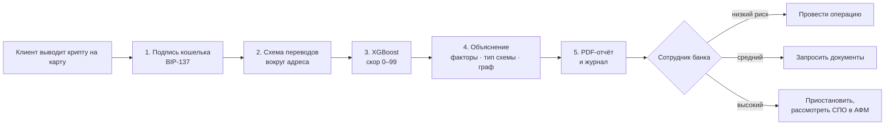
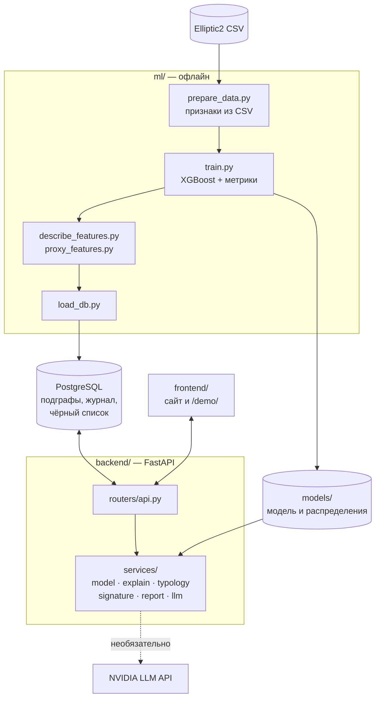
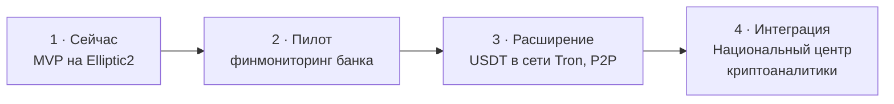

<p align="center">
  
</p>

<h1 align="center">Traceon</h1>

<p align="center">
  <b>Откуда пришли криптовалютные деньги клиента</b><br>
  <sub>ML-сервис для банков Казахстана: оценивает риск отмывания в схеме переводов, объясняет причины по-русски и готовит PDF-отчёт для комплаенса</sub>
</p>

<p align="center">
  
  
  
  
  
  <br>
  
  
  
  
</p>

<p align="center">
  <a href="#зачем-это-нужно">Зачем</a> ·
  <a href="#как-работает">Как работает</a> ·
  <a href="#демо">Демо</a> ·
  <a href="#результаты">Результаты</a> ·
  <a href="#модель">Модель</a> ·
  <a href="#быстрый-старт">Быстрый старт</a> ·
  <a href="#api">API</a> ·
  <a href="#внедрение-и-интеграции">Внедрение</a> ·
  <a href="#ограничения">Ограничения</a>
</p>

<p align="center">
  
</p>

<p align="center">
  <a href="https://macbook-pro-nurbol.tail18e959.ts.net/"><b>Сайт проекта</b></a> ·
  <a href="https://macbook-pro-nurbol.tail18e959.ts.net/demo/"><b>Живое демо</b></a>
</p>

> Проект для **Второго Республиканского конкурса студенческих проектов Ассоциации банков РК** (2026).
> Треки: AI for Finance · Crypto/Blockchain · KYC/AML.

---

## Содержание

- [Зачем это нужно](#зачем-это-нужно)
- [Как работает](#как-работает)
- [Демо](#демо)
- [Результаты](#результаты)
- [Модель](#модель)
  - [Данные](#данные)
  - [Признаки](#признаки)
  - [Обучение и пороги риска](#обучение-и-пороги-риска)
  - [Объяснимость](#объяснимость)
  - [Типы схем](#типы-схем)
- [Архитектура](#архитектура)
- [Быстрый старт](#быстрый-старт)
- [Публикация через Tailscale](#публикация-через-tailscale)
- [API](#api)
- [Структура проекта](#структура-проекта)
- [Внедрение и интеграции](#внедрение-и-интеграции)
- [Ограничения](#ограничения)
- [Безопасность и данные](#безопасность-и-данные)
- [Если что-то не работает](#если-что-то-не-работает)
- [Цитирование и благодарности](#цитирование-и-благодарности)

---

## Зачем это нужно

Клиент банка продал биткоин и вывел деньги на карту. Банк обязан понять, чистые ли это деньги. Сегодня у него три инструмента, и у каждого есть слепое пятно:

| Инструмент | Что делает | Где пропускает |
|---|---|---|
| Реестр преступных криптокошельков АФМ | сверяет адрес со списком | новый кошелёк, созданный вчера, в списке ещё нет |
| Порог обязательного мониторинга, 5 млн ₸ | проверяет крупные операции | сумму дробят на переводы ниже порога |
| KYC биржи | подтверждает, **кто** клиент | не показывает, **откуда** его монеты: через чьи кошельки они прошли |

**Traceon** смотрит не на сам адрес, а на **схему переводов вокруг него**. Модель обучена на 121 тысяче реальных схем Bitcoin и узнаёт признаки отмывания даже у кошельков, которых нет ни в одной базе. Каждый скор объясняется словами, а окончательное решение остаётся за сотрудником банка.

> **Одной фразой:** реестр ловит известных преступников, Traceon находит новых по форме денежного следа и объясняет каждое решение.

## Как работает



1. **Подтверждение владения адресом.** Клиент подписывает короткий текст в своём кошельке (Electrum, Sparrow, Trezor, Ledger — «Подписать сообщение»). Traceon проверяет подпись по стандарту BIP-137: адрес действительно принадлежит клиенту, а секретный ключ никому не передаётся.
2. **Поиск схемы.** Адреса одного владельца объединены в **кластер**, а связанные переводами кластеры образуют **схему (подграф)**: откуда пришли деньги, через сколько кошельков прошли, разошлись или собрались.
3. **Оценка.** Модель XGBoost сравнивает схему с размеченными примерами и выдаёт скор от 0 до 99 и уровень риска.
4. **Объяснение.** Доля влияния групп признаков, факторы риска и смягчающие факторы в сравнении с законными схемами, тип схемы с подсветкой на графе.
5. **Отчёт.** PDF с заключением и рекомендацией. Заключение пишет LLM (NVIDIA API) или шаблон без интернета. Все проверки сохраняются в журнале для регулятора.

<details>
<summary><b>Пример «на пальцах»</b></summary>

Ерлан вывел на карту 3 млн ₸ после продажи биткоина. Банк просит его подписать сообщение кошельком — подпись верна, адрес его.
Traceon находит схему вокруг кошелька: средства пришли от кластера, который за сутки раздал деньги пяти получателям.
Скор 93, «высокий риск», тип схемы — «дробление суммы». Сотрудник видит граф, факторы и рекомендацию: приостановить операцию и запросить документы о происхождении средств.
Если бы схема была обычной, Ерлан прошёл бы проверку без лишних вопросов.

</details>

## Демо

| Адрес | Что там |
|---|---|
| [`/`](https://macbook-pro-nurbol.tail18e959.ts.net/) | сайт проекта: проблема, миссия, результаты, план внедрения, QR-код на демо |
| [`/demo/`](https://macbook-pro-nurbol.tail18e959.ts.net/demo/) | скоринг: проверка кластера, граф, факторы, PDF-отчёт, журнал |
| `/docs` | интерактивная документация API (Swagger) |

<p align="center">
  
</p>

**Сценарий на 2 минуты:**

1. Откройте `/demo/` и выберите пример **«Дробление суммы» (`462721179`)**. Клавиша `/` ставит курсор в поиск.
2. В сводке: скор 93, «высокий риск», строка «Тип схемы: дробление суммы — кластер раздаёт средства 5 получателям».
3. Граф слева: участники схемы подсвечены фиолетовым. Справа заключение, полоса «из чего складывается оценка» и факторы на вкладках.
4. «Скачать PDF» — отчёт для комплаенса. «В чёрный список» — правила банка работают вместе с моделью.
5. «Подтвердить владение адресом» → «Подставить пример» → «Проверить подпись»: демонстрация BIP-137.

<details>
<summary><b>Все демо-кластеры</b></summary>

| Кластер | Что показывает | Скор |
|---|---|---:|
| `434598277` | высокий риск, простой перевод | 99 |
| `718766157` | средний риск | — |
| `535148454` | низкий риск | — |
| `462721179` | дробление суммы, 5 получателей | 93 |
| `566909973` | цепочка («пилинг»), 6 кластеров | 95 |
| `1055671244` | цикл через 5 кластеров | 86 |

Примеры с типами схем взяты из тестовой выборки, которую модель не видела при обучении.
</details>

<p align="center">
  
</p>

## Результаты

Тестовая выборка Elliptic2: **12 181 схема**, подозрительных 2,3%. При таком редком классе главная метрика — PR-AUC.

| Модель | PR-AUC | ROC-AUC |
|---|---:|---:|
| **XGBoost (Traceon)** | **0,579** | **0,940** |
| GLASS, модель авторов датасета | 0,208 | 0,889 |
| Логистическая регрессия | 0,162 | 0,888 |

<p align="center">
  
</p>

**Что это значит на практике:**

| Уровень риска | Схем в тесте | Подозрительных среди них | Доля от всех подозрительных |
|---|---:|---:|---:|
| Высокий | 191 | 68,6% | 47,5% |
| Средний | 1 029 | 8,1% | 30,1% |
| Низкий | 10 961 | 0,6% | 22,5% |

- Среди 1% самых рискованных схем **88,5%** подозрительных — в 39 раз выше средней доли.
- Проверив вручную схемы среднего и высокого риска (10% от всех), комплаенс находит **78%** подозрительных.

> GLASS авторы датасета обучали без признаков кластеров, поэтому сравнение ориентировочное.

## Модель

### Данные

[Elliptic2](https://www.kaggle.com/datasets/ellipticco/elliptic2-data-set) — открытый датасет Elliptic и MIT-IBM Watson AI Lab (Bellei et al., 2024):

- **121 810** размеченных подграфов Bitcoin-переводов, из них 2,3% подозрительных;
- фоновая сеть из **196 млн** переводов между кластерами;
- ID кластеров обезличены, названия признаков скрыты владельцем датасета.

Разбиение стратифицированное, 80 / 10 / 10: **97 448 / 12 181 / 12 181** подграфов (train / validation / test).

### Признаки

Всего **149** признаков трёх групп:

| Группа | Сколько | Что это |
|---|---:|---|
| Скрытые характеристики кластеров | 129 | 43 признака кластеров Elliptic × среднее, максимум и минимум по схеме |
| Форма схемы | 11 | число кластеров и переводов, наибольший веер наружу и внутрь, источники и получатели, плотность, цепочка, доли веера |
| Связи с остальной сетью | 9 | входящие и исходящие связи кластеров схемы во всей сети Bitcoin, переводы наружу и извне, доля внешних связей |

Форму схемы и связи с сетью мы считаем сами (`ml/prepare_data.py`), поэтому их можно объяснить словами.

### Обучение и пороги риска

- `XGBClassifier`: `learning_rate=0.03`, `max_depth=6`, `subsample=0.8`, `colsample_bytree=0.6`, `min_child_weight=2`;
- дисбаланс классов: `scale_pos_weight ≈ 43`;
- ранняя остановка по PR-AUC на validation (`early_stopping_rounds=100`), лучшая итерация — 520.

Вероятность переводится в скор 0–99 с порогами, подобранными на validation:

| Уровень | Вероятность | Скор | Рекомендация |
|---|---|---|---|
| Низкий | < 0,447 | 0–39 | провести операцию, результат в журнале |
| Средний | 0,447–0,840 | 40–69 | запросить документы о происхождении средств |
| Высокий | ≥ 0,840 | 70–99 | приостановить, углублённая проверка, рассмотреть СПО в АФМ |

Скор не бывает выше 99: это вероятность, а не доказательство. Ровно 100 выставляется только при совпадении с чёрным списком.

### Объяснимость

Для каждой проверки считаются SHAP-вклады признаков (встроены в XGBoost) и превращаются в понятный текст (`backend/app/services/explain.py`):

- **Из чего складывается оценка** — доля вклада каждой группы признаков, например «74% — скрытые характеристики кластеров; 25% — связи с сетью; 1% — форма схемы».
- **Факторы риска и смягчающие факторы** — сравнение с распределением у законных схем: «6 — больше, чем у 98% законных схем. Обычно у законных 1, у подозрительных 3». Статистики одной характеристики (max / mean / min) объединяются в один фактор.
- **Понятные «двойники» скрытых признаков.** 32 из 129 скрытых признаков сильно связаны (|r| ≥ 0,6, корреляция Спирмена) с показателями сети, которые мы считаем сами. Такие факторы подписаны словами: «связана с тем, сколько разных источников присылают средства кластерам схемы». Это статистическая связь, а не расшифровка (`ml/proxy_features.py`).
- **Честные оговорки.** Если фактор влияет против «наивного» направления, к нему добавляется «влияет в сочетании с другими признаками».

### Типы схем

`backend/app/services/typology.py` распознаёт типовые рисунки по реальным переводам внутри схемы:

| Тип | Как определяется |
|---|---|
| Цепочка («пилинг») | средства последовательно проходят через 3+ кластера один за другим |
| Дробление суммы | один кластер отправляет средства 3+ получателям |
| Сбор средств | один кластер получает средства от 3+ отправителей |
| Сбор и раздача | кластер и собирает, и раздаёт средства |
| Цикл | средства возвращаются к отправителю |

**Важный вывод из данных:** доля подозрительных у всех типов почти одинакова — 1,5–2,7% при среднем 2,3% (`ml/describe_features.py`). Правило «цикл значит отмывание» не работает, поэтому риск оценивает модель, а тип схемы помогает сотруднику понять, что он видит на графе.

## Архитектура



Всё работает в Docker: `db` (PostgreSQL 16), `api` (FastAPI и статика), `ml` (инструменты обучения, профиль `tools`). Шрифты и библиотека графа лежат локально, поэтому демо работает без интернета.

## Быстрый старт

Нужен [Docker Desktop](https://www.docker.com/products/docker-desktop/) с 8 ГБ памяти и больше.

```bash
git clone https://github.com/fortitude-devops/traceon.git
cd traceon
```

### Пробный запуск на синтетике (5 минут)

Проверяет, что всё работает, до скачивания большого датасета:

```bash
docker compose up -d db
docker compose --profile tools build
docker compose run --rm ml ml/make_sample_data.py
docker compose run --rm ml ml/prepare_data.py
docker compose run --rm ml ml/train.py
docker compose run --rm ml ml/load_db.py
docker compose up -d --build api
```

Откройте http://localhost:8000. Метрики на синтетике ничего не значат.

### Настоящий датасет

1. Скачайте Elliptic2 с [Kaggle](https://www.kaggle.com/datasets/ellipticco/elliptic2-data-set) и положите в `data/elliptic2/` файлы
   `connected_components.csv`, `nodes.csv`, `edges.csv`, `background_nodes.csv`, `background_edges.csv`.
   В `background_edges.csv` около 196 млн строк — проверьте свободное место на диске.
2. Подготовка, обучение, загрузка:
   ```bash
   docker compose run --rm ml ml/prepare_data.py
   docker compose run --rm ml ml/train.py
   docker compose run --rm ml ml/describe_features.py
   docker compose run --rm ml ml/proxy_features.py
   docker compose run --rm ml ml/load_db.py
   docker compose up -d --build api
   ```
   `prepare_data.py` читает большие файлы потоково. Для пробы на части данных: `--limit-rows 5000000`.

<details>
<summary><b>ML-скрипты без Docker (быстрее на Mac)</b></summary>

У Docker на Mac медленный доступ к файлам, поэтому обрабатывать гигантские CSV быстрее напрямую:

```bash
brew install python@3.12 libomp
python3.12 -m venv .venv && source .venv/bin/activate
pip install -r requirements.txt
cp .env.example .env          # DATABASE_URL указывает на базу из Docker (порт 5433)

docker compose up -d db
python ml/prepare_data.py
python ml/train.py
python ml/describe_features.py
python ml/proxy_features.py
python ml/load_db.py
docker compose up -d --build api
```
</details>

<details>
<summary><b>Заключение через LLM (необязательно)</b></summary>

Получите ключ на build.nvidia.com и запустите сервис с ним:

```bash
NVIDIA_API_KEY=... docker compose up -d api
```

LLM только пересказывает результат модели и решений не принимает. Без ключа или без интернета заключение собирается по шаблону — демо работает всегда.
</details>

<details>
<summary><b>Чёрный список из файла</b></summary>

Положите `data/blacklist.csv` с колонками `cl_id,source,reason` — его подхватит `load_db.py`. Совпадение с чёрным списком поднимает скор до 100 (если в списке сам кластер) или минимум до 85 (если кластер из той же схемы).
</details>

## Публикация через Tailscale

Сервер работает на своём компьютере, а [Tailscale Funnel](https://tailscale.com/kb/1223/tailscale-funnel) даёт ему публичный https-адрес.

```bash
docker compose up -d --build api
tailscale funnel --bg 8000
tailscale funnel status          # адрес вида https://<устройство>.<tailnet>.ts.net
```

При первом запуске Tailscale попросит разрешить Funnel в админ-панели. Выключить: `tailscale funnel --bg 8000 off`.

QR-код на сайте строится по адресу, с которого открыта страница. На `localhost` он не показывается, потому что с телефона такой адрес не откроется. Чтобы QR был правильным всегда, впишите публичный адрес в `frontend/index.html`:

```html
<meta name="traceon-demo" content="https://<устройство>.<tailnet>.ts.net/demo/">
```

## API

Документация в Swagger: `/docs`.

| Метод | Путь | Что делает |
|---|---|---|
| GET | `/api/health` | состояние базы и модели |
| GET | `/api/model` | метрики модели и сравнение с GLASS |
| GET | `/api/demo` | демо-кластеры |
| POST | `/api/check` | проверить кластер или подграф |
| GET | `/api/graph/{cc_id}` | граф переводов подграфа |
| POST | `/api/verify-signature` | проверить подпись владельца адреса |
| GET | `/api/report/{check_id}` | PDF-отчёт |
| GET | `/api/history` | журнал проверок |
| GET/POST/DELETE | `/api/blacklist` | чёрный список кластеров |

<details>
<summary><b>Пример: проверка кластера</b></summary>

```bash
curl -s -X POST http://localhost:8000/api/check \
  -H "Content-Type: application/json" \
  -d '{"query": "462721179"}'
```

Ответ (сокращён):

```json
{
  "check_id": 7,
  "query": "462721179",
  "cc_id": "11488",
  "score": 93,
  "level": "high",
  "level_ru": "Высокий риск",
  "scheme": "дробление суммы — кластер 462721179 раздаёт средства 5 получателям",
  "reasons": {
    "groups": [
      {"key": "hidden", "name": "Скрытые характеристики кластеров", "share": 0.58},
      {"key": "network", "name": "Связи кластеров с остальной сетью", "share": 0.39},
      {"key": "structure", "name": "Форма схемы", "share": 0.03}
    ],
    "risk": [
      {"text": "Скрытая характеристика кластеров №29, наибольшая в схеме: 6 — больше, чем у 99% законных схем…",
       "group": "hidden", "strength": "сильное", "share": 0.18}
    ],
    "mitigating": ["…"]
  },
  "conclusion": "Схема переводов оценена как «высокий риск» (93 из 100)…"
}
```
</details>

<details>
<summary><b>Пример: проверка подписи</b></summary>

```bash
curl -s -X POST http://localhost:8000/api/verify-signature \
  -H "Content-Type: application/json" \
  -d '{"address": "bc1q…", "message": "Я, клиент №…, подтверждаю владение адресом…", "signature": "H…"}'
```

Ответ: `{"valid": true, "address_type": "…"}` или `{"valid": false, "error": "…"}`.
</details>

## Структура проекта

```
traceon/
├── backend/app/
│   ├── main.py               FastAPI: API и раздача сайта
│   ├── config.py, db.py
│   ├── routers/api.py        эндпоинты
│   └── services/
│       ├── model.py          загрузка модели, SHAP-вклады
│       ├── explain.py        факторы, группы, понятные формулировки
│       ├── typology.py       типы схем по реальным переводам
│       ├── signature.py      проверка подписи BIP-137
│       ├── report.py         PDF-отчёт
│       └── llm.py            заключение через LLM или шаблон
├── frontend/
│   ├── index.html            сайт проекта
│   ├── demo/                 интерфейс скоринга
│   └── vendor/               граф и шрифты локально
├── ml/
│   ├── make_sample_data.py   синтетика для проверки
│   ├── prepare_data.py       признаки подграфов из CSV Elliptic2
│   ├── train.py              обучение XGBoost и метрики
│   ├── describe_features.py  распределения признаков и статистика типов схем
│   ├── proxy_features.py     понятные «двойники» скрытых признаков
│   └── load_db.py            загрузка в PostgreSQL
├── docs/                     картинки для README
├── data/                     датасет (не входит в репозиторий)
└── models/                   обученная модель (не входит в репозиторий)
```

## Внедрение и интеграции



| Система | Роль Traceon |
|---|---|
| Системы финмониторинга банков | ближайший шаг: API для проверки входящих переводов с криптобирж, PDF как основа для СПО |
| [Национальный центр криптовалютной аналитики](https://kapital.kz/finance/152930/v-kazahstane-sozdadut-nacionalnyj-centr-kriptovalyutnoj-analitiki.html) | цель: ML-модуль, который оценивает схемы и находит новые подозрительные кластеры |
| [Реестр криптокошельков АФМ](https://informburo.kz/novosti/reestr-kriptokoselkov-sviazannyx-s-prestupnoi-deiatelnostiu-sozdadut-v-kazaxstane) | адреса из реестра — стартовые метки; Traceon предлагает соседние неизвестные кластеры для проверки |
| [Антифрод-центр Нацбанка](https://nationalbank.kz/ru/news/informacionnye-soobshcheniya/17754) | для будущего модуля P2P и «треугольных» схем на стороне переводов в тенге |
| Биржи с лицензией МФЦА | данные о сделках по Travel Rule вместо ручной сверки ордеров |

<details>
<summary><b>А если клиент продал крипту через P2P?</b></summary>

При P2P-продаже банк видит только перевод в тенге от незнакомого человека, а сама сделка проходит внутри биржи и в блокчейн не попадает. Связка строится так:

1. банк замечает P2P-профиль карты: много входящих от несвязанных людей, круглые суммы;
2. при углублённой проверке клиент показывает ордер с биржи — имя покупателя, сумма и время должны совпасть с переводом;
3. Traceon проверяет происхождение монет: схему вокруг кошелька, с которого биткоин пришёл на биржу.

Следующий шаг развития — модуль, который распознаёт P2P и треугольные схемы мошенничества на стороне переводов в тенге.
</details>

## Ограничения

- **Только Bitcoin.** Для USDT в сети Tron модель нужно переобучить на новых данных.
- **Признаки обезличены.** Часть факторов показана номерами; на данных банка с открытыми признаками этого не будет.
- **Разметка датасета, а не банка.** Метки поставил Elliptic; качество нужно подтвердить на пилоте с реальными решениями комплаенса.
- **Скор не доказательство.** Он показывает сходство со схемами отмывания; решение и СПО остаются за сотрудником.
- **Демо не связывает подпись и скоринг одним адресом**, потому что ID в Elliptic2 обезличены. В рабочей версии адрес → кластер → схема определяется автоматически.

## Безопасность и данные

- Секретов в репозитории нет: ключ LLM передаётся через `.env` или переменную окружения, `.env` в `.gitignore`.
- Датасет и обученная модель не публикуются (`data/`, `models/` в `.gitignore`).
- Проверка подписи не требует и не принимает приватный ключ клиента.
- Сервис работает в контуре банка: Docker, без обязательного доступа в интернет.
- В демо нет персональных данных: ID кластеров в Elliptic2 обезличены.

## Если что-то не работает

| Проблема | Решение |
|---|---|
| Порт 5432 занят | база Docker открыта на 5433 |
| Порт 8000 занят | замените `"8000:8000"` на `"8080:8000"` в `docker-compose.yml` |
| «Модель не обучена» | выполните `train.py`, затем `docker compose restart api` |
| Изменения не видны на сайте | `docker compose up -d --build api` и Cmd+Shift+R в браузере |
| XGBoost на Mac ругается на libomp | `brew install libomp` |
| QR-код не открывается с телефона | откройте сайт по публичному адресу или задайте `traceon-demo` (см. [Публикация](#публикация-через-tailscale)) |
| Логи сервиса | `docker compose logs -f api` |
| Начать с чистой базы | `docker compose down -v` (журнал проверок удалится) |

## Цитирование и благодарности

Датасет:

```bibtex
@article{bellei2024elliptic2,
  title   = {The Shape of Money Laundering: Subgraph Representation Learning on the Blockchain with the Elliptic2 Dataset},
  author  = {Bellei, Claudio and Xu, Muhua and Phillips, Ross and Robinson, Tom and Weber, Mark and Kaler, Tim and Leiserson, Charles E. and Arvind and Chen, Jie},
  journal = {arXiv preprint arXiv:2404.19109},
  year    = {2024}
}
```

Граф — [vis-network](https://visjs.github.io/vis-network/). Шрифты — IBM Plex Sans, DejaVu Sans, Unbounded, Onest, JetBrains Mono.

**Команда:** [Имя Фамилия], [вуз, группа] · [email]

**Лицензия:** [выберите лицензию для кода]. Условия использования датасета Elliptic2 — на его [странице Kaggle](https://www.kaggle.com/datasets/ellipticco/elliptic2-data-set).
