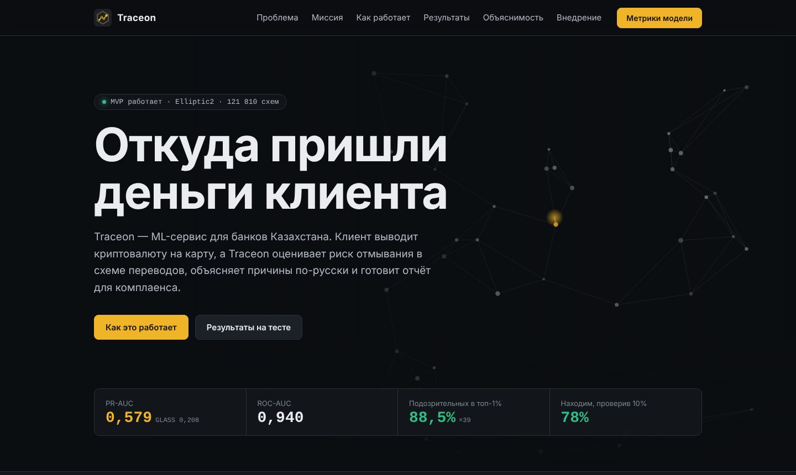
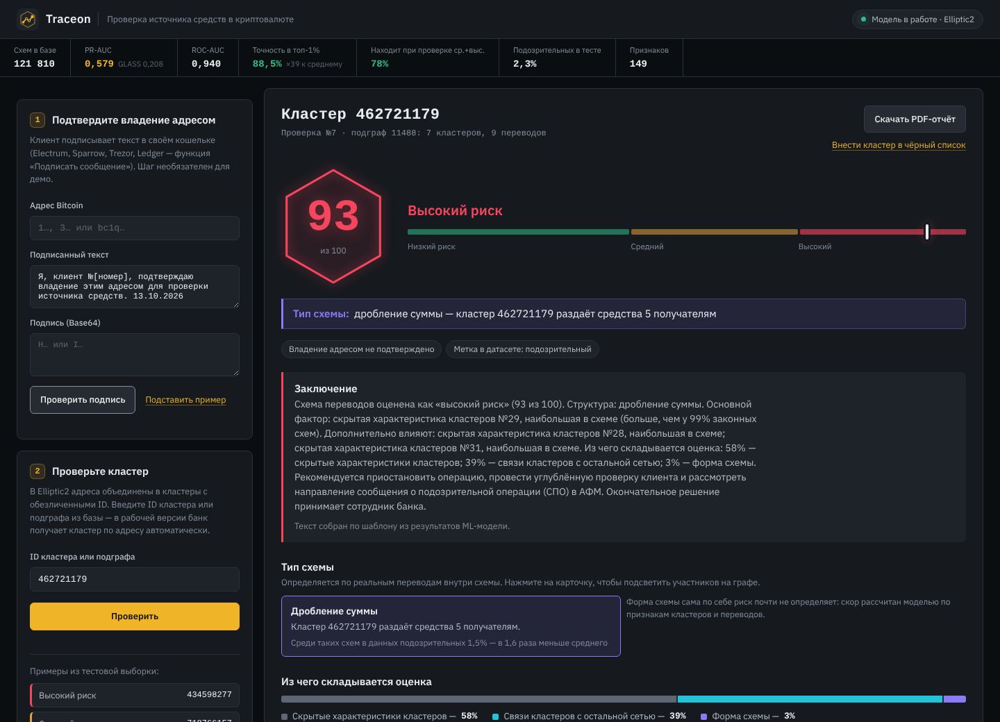
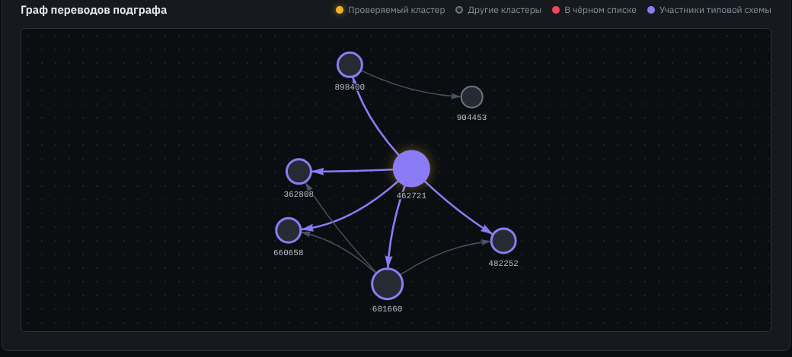
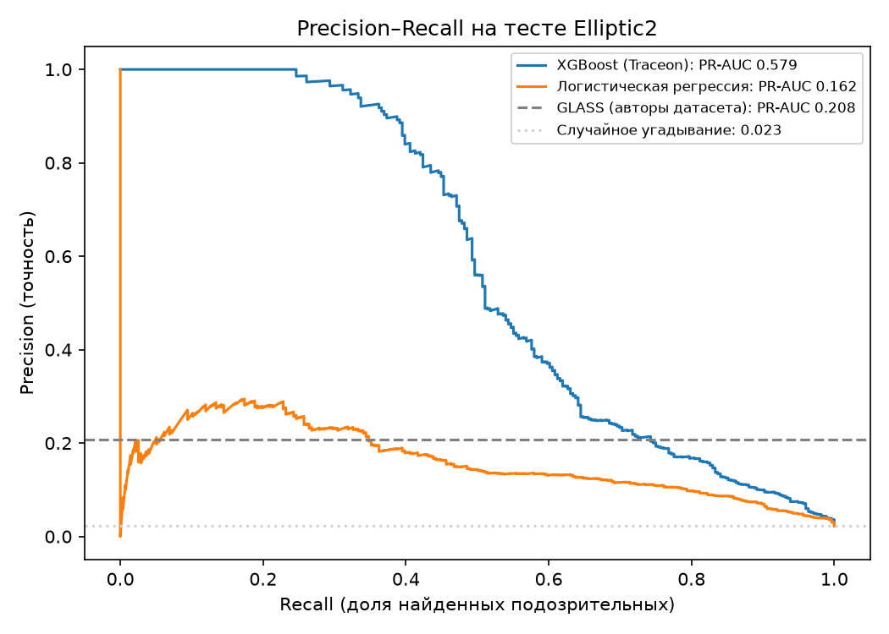

<p align="center">
  
</p>

<h1 align="center">Traceon</h1>

<p align="center">
  <b>ML-сервис для банков Казахстана: откуда пришли криптовалютные деньги клиента</b><br>
  <sub>Оценивает риск отмывания в схеме переводов, объясняет причины по-русски и готовит PDF-отчёт для комплаенса</sub>
</p>

<p align="center">
  
  
  
  
  
  
  
</p>

<p align="center">
  <a href="#демо">Демо</a> ·
  <a href="#результаты">Результаты</a> ·
  <a href="#как-работает">Как работает</a> ·
  <a href="#быстрый-старт">Быстрый старт</a> ·
  <a href="#публикация-через-tailscale">Публикация</a> ·
  <a href="#api">API</a> ·
  <a href="#ограничения">Ограничения</a>
</p>

---

Клиент банка выводит криптовалюту на карту. Реестр преступных кошельков АФМ знает только уже пойманные адреса,
пороговые правила обходят дроблением суммы, а KYC говорит, **кто** клиент, но не **откуда** его монеты.

**Traceon** смотрит на схему переводов вокруг адреса и находит признаки отмывания, даже если кошелька ещё нет ни в одной базе.
Каждый скор объясняется: какие факторы повысили риск, какие снизили и какой тип схемы виден на графе.
Окончательное решение остаётся за сотрудником банка.

> Проект для Второго Республиканского конкурса студенческих проектов Ассоциации банков РК (2026).
> Треки: AI for Finance, Crypto/Blockchain, KYC/AML.

<p align="center">
  
</p>

## Демо

| Адрес | Что там |
|---|---|
| `/` | сайт проекта: проблема, миссия, результаты, план внедрения |
| `/demo/` | скоринг: проверка кластера, граф, факторы, PDF-отчёт |
| `/docs` | интерактивная документация API |

<p align="center">
  
</p>

**Сценарий на 2 минуты:**

1. На `/demo/` нажмите «Подставить пример» → «Проверить подпись»: клиент доказал владение адресом по стандарту BIP-137.
2. Выберите пример слева, например **«Дробление суммы» (`462721179`)**: скор 93, тип схемы, заключение, факторы.
3. Покажите граф: участники схемы подсвечены фиолетовым. Нажмите «Скачать PDF-отчёт».
4. «Внести кластер в чёрный список»: правила банка работают вместе с моделью.

<p align="center">
  
</p>

## Результаты

Тестовая выборка Elliptic2: **12 181 схема**, подозрительных 2,3%. Главная метрика при редком классе — PR-AUC.

| Модель | PR-AUC | ROC-AUC |
|---|---:|---:|
| **XGBoost (Traceon)** | **0,579** | **0,940** |
| GLASS, модель авторов датасета | 0,208 | 0,889 |
| Логистическая регрессия | 0,162 | 0,888 |

- Среди 1% самых рискованных схем **88,5%** подозрительных — в 39 раз выше средней доли.
- Проверив вручную 10% схем, комплаенс находит **78%** подозрительных.
- В уровень «высокий риск» попала 191 схема, 69% из них подозрительные.

GLASS авторы обучали без признаков кластеров, поэтому сравнение ориентировочное.

<p align="center">
  
</p>

## Как работает

1. **Подпись.** Клиент подписывает текст в своём кошельке (Electrum, Sparrow, Trezor, Ledger), Traceon проверяет подпись по BIP-137.
2. **Скоринг.** По кластеру находится подграф переводов, XGBoost на 149 признаках выдаёт скор 0–99.
3. **Объяснение.**
   - доля влияния групп признаков: скрытые характеристики кластеров, связи с сетью, форма схемы;
   - факторы риска и смягчающие факторы в сравнении с законными схемами («больше, чем у 98% законных»);
   - тип схемы по реальным переводам: цепочка («пилинг»), дробление, сбор, сбор и раздача, цикл;
   - 32 скрытых признака Elliptic подписаны понятными словами через корреляцию с показателями сети (`ml/proxy_features.py`).
4. **Отчёт.** PDF с заключением и рекомендацией: продолжить, запросить документы или рассмотреть СПО в АФМ. Заключение пишет LLM (NVIDIA API) или шаблон без интернета.

### Данные

[Elliptic2](https://www.kaggle.com/datasets/ellipticco/elliptic2-data-set) (Bellei et al., 2024): 121 810 размеченных подграфов
Bitcoin-переводов между **кластерами** адресов на фоне сети из 196 млн переводов. ID кластеров обезличены, названия признаков скрыты.
Поэтому в демо проверка идёт по ID кластера; в рабочей версии банк получает кластер по адресу клиента автоматически.

## Быстрый старт

Нужен [Docker Desktop](https://www.docker.com/products/docker-desktop/) с 8 ГБ памяти и больше.

```bash
git clone https://github.com/fortitude-devops/traceon.git
cd traceon
```

### Пробный запуск на синтетике (5 минут)

```bash
docker compose up -d db
docker compose --profile tools build
docker compose run --rm ml ml/make_sample_data.py
docker compose run --rm ml ml/prepare_data.py
docker compose run --rm ml ml/train.py
docker compose run --rm ml ml/load_db.py
docker compose up -d --build api
```

Откройте http://localhost:8000. Метрики на синтетике ничего не значат.

### Настоящий датасет

1. Скачайте Elliptic2 с [Kaggle](https://www.kaggle.com/datasets/ellipticco/elliptic2-data-set) и положите CSV в `data/elliptic2/`:
   `connected_components.csv`, `nodes.csv`, `edges.csv`, `background_nodes.csv`, `background_edges.csv`.
   В `background_edges.csv` около 196 млн строк, проверьте свободное место.
2. Подготовка, обучение, загрузка:
   ```bash
   docker compose run --rm ml ml/prepare_data.py
   docker compose run --rm ml ml/train.py
   docker compose run --rm ml ml/describe_features.py
   docker compose run --rm ml ml/proxy_features.py
   docker compose run --rm ml ml/load_db.py
   docker compose up -d --build api
   ```

<details>
<summary>Запуск ML-скриптов без Docker (быстрее на Mac)</summary>

```bash
brew install python@3.12 libomp
python3.12 -m venv .venv && source .venv/bin/activate
pip install -r requirements.txt
cp .env.example .env          # DATABASE_URL указывает на базу из Docker (порт 5433)

docker compose up -d db
python ml/prepare_data.py
python ml/train.py
python ml/describe_features.py
python ml/proxy_features.py
python ml/load_db.py
docker compose up -d --build api
```
</details>

<details>
<summary>Заключение через LLM (необязательно)</summary>

Получите ключ на build.nvidia.com и запустите сервис с ним:

```bash
NVIDIA_API_KEY=... docker compose up -d api
```

LLM только пересказывает результат модели и решений не принимает. Без ключа заключение собирается по шаблону.
</details>

## Публикация через Tailscale

Сервер работает на своём компьютере, а [Tailscale Funnel](https://tailscale.com/kb/1223/funnel) даёт ему публичный https-адрес.

```bash
docker compose up -d --build api
tailscale funnel --bg 8000
tailscale funnel status          # покажет адрес вида https://<устройство>.<tailnet>.ts.net
```

При первом запуске Tailscale попросит разрешить Funnel в админ-панели. QR-код на сайте строится по адресу сервера автоматически;
чтобы задать другой адрес демо, впишите его в `<meta name="traceon-demo" content="">` в `frontend/index.html`.

## Структура

```
traceon/
├── backend/app/
│   ├── main.py               FastAPI: API и раздача сайта
│   ├── routers/api.py        эндпоинты
│   └── services/             модель, объяснения, типы схем, подпись BIP-137, PDF, LLM
├── frontend/
│   ├── index.html            сайт проекта
│   ├── demo/                 интерфейс скоринга
│   └── vendor/               граф и шрифты локально — работает без интернета
├── ml/
│   ├── make_sample_data.py   синтетика для проверки
│   ├── prepare_data.py       признаки подграфов из CSV Elliptic2
│   ├── train.py              обучение XGBoost и метрики
│   ├── describe_features.py  распределения признаков и статистика типов схем
│   ├── proxy_features.py     понятные «двойники» скрытых признаков
│   └── load_db.py            загрузка в PostgreSQL
├── docs/                     картинки для README
├── data/                     датасет (в репозиторий не входит)
└── models/                   обученная модель (в репозиторий не входит)
```

## API

| Метод | Путь | Что делает |
|---|---|---|
| GET | `/api/health` | состояние базы и модели |
| GET | `/api/model` | метрики модели и сравнение с GLASS |
| GET | `/api/demo` | демо-кластеры |
| POST | `/api/check` | проверить кластер или подграф: `{"query": "...", "ownership": {...}}` |
| GET | `/api/graph/{cc_id}` | граф переводов подграфа |
| POST | `/api/verify-signature` | проверить подпись владельца адреса |
| GET | `/api/report/{check_id}` | PDF-отчёт |
| GET | `/api/history` | журнал проверок |
| GET/POST/DELETE | `/api/blacklist` | чёрный список кластеров |

## Ограничения

- **Только Bitcoin.** Для USDT в сети Tron модель нужно переобучить на новых данных.
- **Признаки обезличены.** Часть факторов показана номерами; на данных банка с открытыми признаками этого не будет.
- **Разметка датасета, а не банка.** Качество нужно подтвердить на пилоте с реальными решениями комплаенса.
- **Скор не доказательство.** Он показывает сходство со схемами отмывания; решение и СПО остаются за сотрудником.
- В демо проверка подписи и скоринг не связаны одним реальным адресом, потому что ID в Elliptic2 обезличены.

## Если что-то не работает

- **Порт 5432 занят** — база Docker открыта на 5433.
- **Порт 8000 занят** — замените `"8000:8000"` на `"8080:8000"` в `docker-compose.yml`.
- **«Модель не обучена»** — выполните `train.py`, затем `docker compose restart api`.
- **Изменения не видны на сайте** — `docker compose up -d --build api` и Cmd+Shift+R в браузере.
- **Логи** — `docker compose logs -f api`.

## Благодарности

Датасет: Bellei C. et al. *The Shape of Money Laundering: Subgraph Representation Learning on the Blockchain with the Elliptic2 Dataset*, 2024.
Граф: [vis-network](https://visjs.github.io/vis-network/). Шрифты: IBM Plex Sans, DejaVu Sans.
